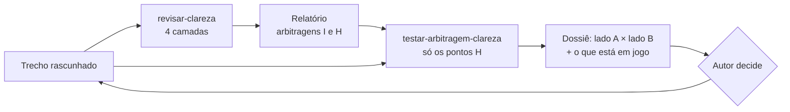
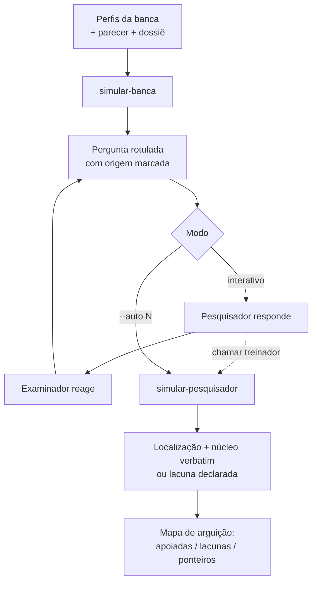
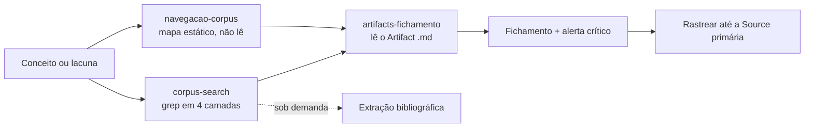
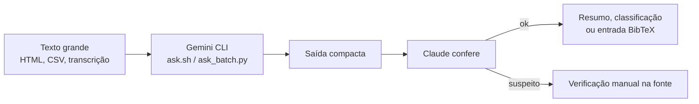
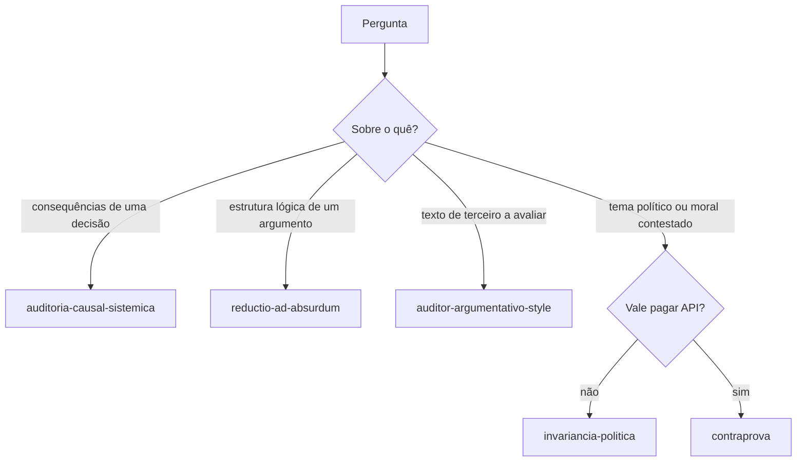

# Cadeias entre skills

Algumas skills só fazem sentido quando usadas junto com outras. Os diagramas abaixo mostram essas ligações.

## Cadeia de clareza

`revisar-clareza` arbitra tensões entre autores e marca cada arbitragem com `[I]` ou `[H]`. `testar-arbitragem-clareza` recebe o relatório, ataca só as arbitragens `[H]` e devolve a decisão ao autor.

## Cadeia da defesa

`simular-banca` encena os examinadores. Quando o pesquisador trava, ou no modo `--auto`, ela chama `simular-pesquisador`, que só aponta onde a resposta está no texto. A banca pergunta, o treinador ancora e o pesquisador responde.

## Cadeia do corpus

As três skills de corpus dividem o trabalho por custo. `navegacao-corpus` só indica caminhos, `corpus-search` localiza com grep antes de ler e `artifacts-fichamento` lê e ficha.

## Padrão de delegação ao Gemini

`gemini-delegate` é a ferramenta genérica. `gemini-source-extractor`, ainda experimental, aplica o mesmo padrão à extração bibliográfica. O Gemini lê muito e devolve pouco; o Claude confere e decide.

## Protocolos de raciocínio: qual usar

