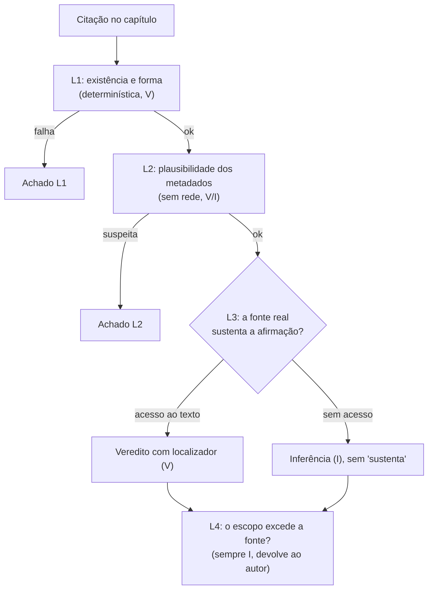

# auditar-citacoes — análise

**Complexidade:** alta — quatro camadas de custo crescente, regra-mestra sobre fontes, vereditos padronizados

| Forças | Fraquezas |
|---|---|
| • Verifica se a fonte diz o que o texto diz que ela diz, não só se a chave existe no .bib. • Organiza as camadas por custo, das baratas e determinísticas às caras e interpretativas. • Nunca dá "sustenta" sem localizador da passagem. | • A L4 (escopo) é conservadora de propósito e deixa passar exageros sutis. • Não detecta citação ausente, só citação presente mal usada. • Livros sem texto disponível ficam em [I] por limitação de acesso. |

| Oportunidades | Ameaças |
|---|---|
| • Pode virar etapa obrigatória antes de qualquer submissão a periódico. | • Busca semântica e NotebookLM podem ser confundidos com fonte; a skill proíbe isso, mas a tentação continua. |

## Fluxo

