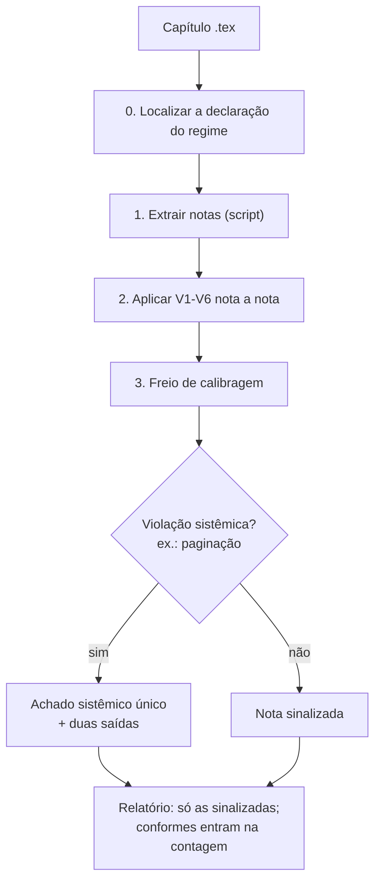

# auditoria-regime-notas — análise

**Complexidade:** alta — seis violações com teste próprio, script de extração, freio de calibragem

| Forças | Fraquezas |
|---|---|
| • Não reduz notas: só aponta as que violam o regime declarado pelo próprio autor. • Cada violação tem um teste operacional, como o teste de apagamento da V1. • Lista também o que NÃO sinalizar, o que evita falsos positivos. | • Pressupõe um regime corpo/nota declarado; sem ele, não há o que auditar. • Os exemplos são poucos e genéricos; o regime de cada projeto precisa ser descrito por quem usa. |

| Oportunidades | Ameaças |
|---|---|
| • O modelo de regime declarado e auditado serve para qualquer trabalho com muitas notas. | • Os testes V1 e V2 dependem de julgamento; o freio de calibragem reduz o erro, mas não o elimina. |

## Fluxo

