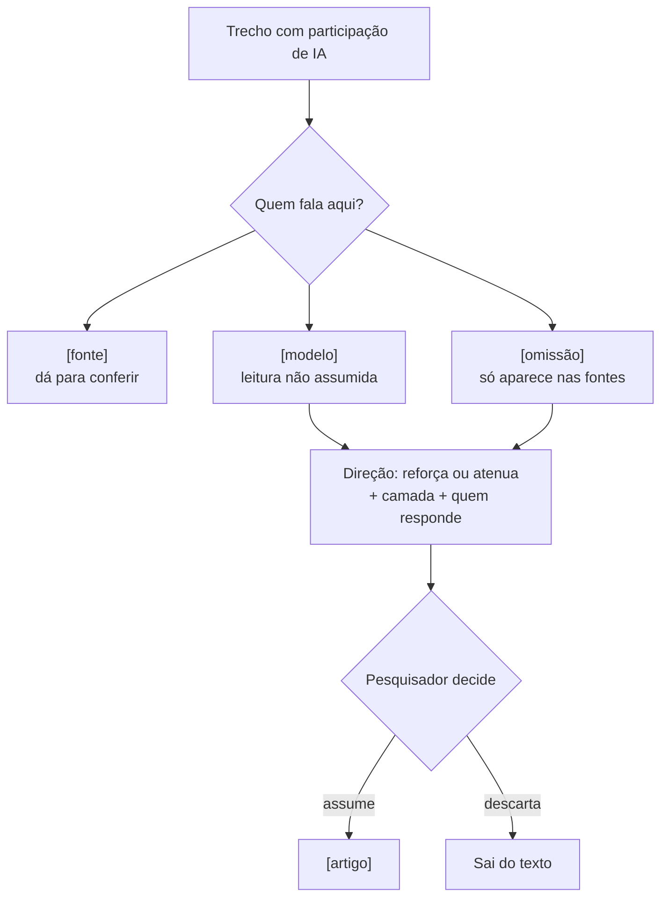

# quem-fala — análise

**Complexidade:** média — dois modos (redigir e auditar), formato de registro fixo, sem dependências

| Forças | Fraquezas |
|---|---|
| • Uma pergunta só organiza tudo: quem fala aqui, e alguém humano assumiu isso? • Troca a dicotomia fato/valor por proveniência e assunção, que dá para conferir linha a linha. • Procura viés nas duas direções: complacência com o pesquisador e interesse da empresa que treinou o modelo. • Audita sem reescrever: só acrescenta comentários, e a prosa fica idêntica. | • É autoauditoria do mesmo modelo que redigiu, e a própria skill declara essa parcialidade. • Depende de voltar às fontes; sem acesso a elas, a omissão não aparece. • A lista de sinais nasceu de quatro arquivos de um único artigo. |

| Oportunidades | Ameaças |
|---|---|
| • Dá conteúdo verificável à declaração de uso de IA exigida por periódicos. • O registro das marcas pode virar dado de pesquisa e sustentar uma nota metodológica. | • As marcas podem dar ao texto uma aparência de controle que a autoauditoria não garante. • Marcar como `[modelo]` não basta: o risco é o pesquisador assumir em bloco, sem ler. |

## Fluxo

