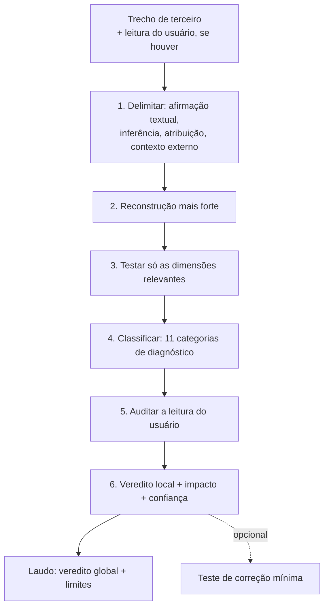

# auditor-argumentativo-style — análise

**Complexidade:** alta — procedimento em seis passos, duas taxonomias (categoria e veredito), laudo com formato fixo

| Forças | Fraquezas |
|---|---|
| • Audita também a leitura do usuário, não só o texto de terceiro. • Tem taxonomia fina de diagnósticos e proíbe "ponto cego" genérico. • Aceita laudo com zero problemas: não exige cota de críticas. | • O laudo completo é longo para trechos curtos. • O atrito fixo em 4 de 5 pode cansar em conversas exploratórias. |

| Oportunidades | Ameaças |
|---|---|
| • O formato de laudo pode ser usado em pareceres de periódico e em leitura de banca. • Combina com reductio-ad-absurdum quando o diagnóstico é falha lógica. | • O "teste de correção mínima" pode escorregar para reescrever o texto de terceiro. |

## Fluxo

