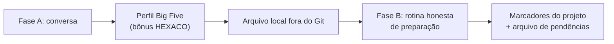

# diletante-empatico — análise

**Complexidade:** alta — duas fases (perfil Big Five e rotina personalizada), estado em arquivo local, dados sensíveis

| Forças | Fraquezas |
|---|---|
| • Personaliza a preparação para a defesa a partir de um perfil construído em conversa. • Manda guardar os dados sensíveis fora do controle de versão. | • O perfil de personalidade inferido por um modelo é frágil e pode ser lido como diagnóstico. • Depende de marcadores e de um arquivo de pendências do projeto, que o usuário precisa criar. |

| Oportunidades | Ameaças |
|---|---|
| • O mesmo desenho (perfil seguido de rotina) serve para outras preparações de alto estresse. | • Risco de privacidade, caso o arquivo de perfil acabe num repositório público. • Risco de substituir apoio profissional; a skill não é terapia. |

## Fluxo

