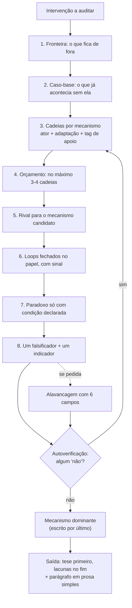

# auditoria-causal-sistemica — análise

**Complexidade:** alta — oito operações com artefato obrigatório, ordem de construção imposta, autoverificação

| Forças | Fraquezas |
|---|---|
| • Nomeia as quatro patologias que combate (efeito-enciclopédia, paradoxo fabricado, ancoragem-na-tese, setas vazias); o leitor sabe o que conferir. • Troca "provável" por tags de apoio (demonstrado / mecanístico / conjectural), que o leitor consegue auditar. • Separa ordem de construção de ordem de apresentação: a tese vem primeiro no texto, mas é escrita por último. | • É pesada: num caso pequeno, as oito operações tendem a inflar, apesar do aviso sobre densidade. • O exemplo do caso-base (detectores de IA na universidade) vem do domínio de origem; em outros domínios, quem usa precisa transpor. • O parágrafo final "à la Zinsser" foi acrescentado depois do resto e não passa pela autoverificação. |

| Oportunidades | Ameaças |
|---|---|
| • Pode servir de gabarito de revisão para relatórios de impacto, pareceres e projetos de política pública. • Combina com reductio-ad-absurdum: uma audita consequências, a outra a estrutura lógica. | • O modelo pode cumprir a forma sem a substância e rotular como "mecanístico" o que é palpite. A skill reduz esse risco, mas não o elimina, e diz isso. • Quem só lê a tese pula as lacunas declaradas no fim. |

## Fluxo

## Nota

O eixo 1ª/2ª/3ª ordem, usado em analista-sistemico-style, é abandonado aqui de propósito. As duas skills, lidas juntas, mostram a evolução do método.
