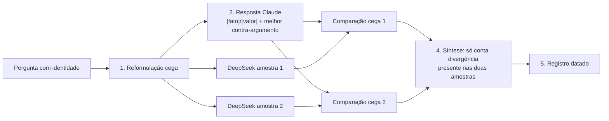

# contraprova — análise

**Complexidade:** alta — dois scripts, API externa paga, comparação cega com duas amostras, registro em arquivo

| Forças | Fraquezas |
|---|---|
| • Tira o teste de viés do próprio modelo: um segundo modelo responde à pergunta cega. • Faz a comparação às cegas, com o mapa de origem revelado só no fim. • Usa duas amostras para separar divergência estável de ruído do modelo externo. | • Custa dinheiro: quatro chamadas pagas por contraprova, mais no teste de invariância. • Depende de um único fornecedor externo (DeepSeek); se a API mudar, os scripts quebram em silêncio ou com erro pouco claro. • Os scripts não foram executados na preparação deste repositório. |

| Oportunidades | Ameaças |
|---|---|
| • Trocar o modelo externo, ou acrescentar um terceiro, é mudança pequena nos scripts. • Os registros datados formam, com o tempo, um corpus de divergências entre modelos. | • Concordância entre modelos não é verdade, porque os corpora de treino se sobrepõem. A skill avisa isso. • O DeepSeek tem restrições conhecidas em temas ligados à China. |

## Fluxo

## Nota

Requer `DEEPSEEK_API_KEY`. Veja o aviso no SKILL.md.
