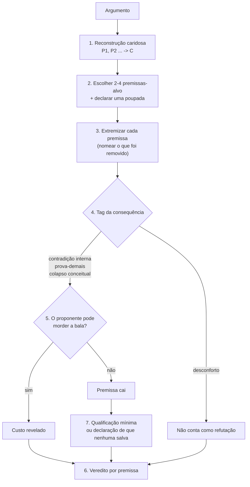

# reductio-ad-absurdum — análise

**Complexidade:** alta — sete operações, tags de consequência, teste obrigatório da bala mordida

| Forças | Fraquezas |
|---|---|
| • Distingue contradição de desconforto, a confusão mais comum em reductio. • Trata a "bala mordida" como resultado legítimo (custo revelado), não como fracasso. • Exige a qualificação mínima que salvaria a premissa, o que torna a crítica construtiva. | • Depende de uma reconstrução caridosa feita pelo próprio modelo, que pode errar sem que o protocolo perceba. • Não serve para desacordos empíricos, e a própria skill avisa isso. |

| Oportunidades | Ameaças |
|---|---|
| • É útil para ensinar argumentação: o formato de saída funciona como exercício didático. • Pode alimentar a seção de "objeções antecipadas" de um texto acadêmico. | • A tag "prova-demais" pode virar atalho retórico se a premissa extremizada não for a que o proponente sustenta (patologia 1). |

## Fluxo

